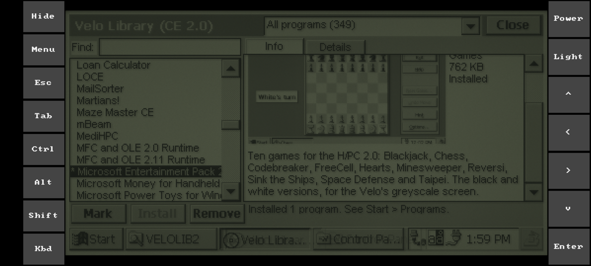
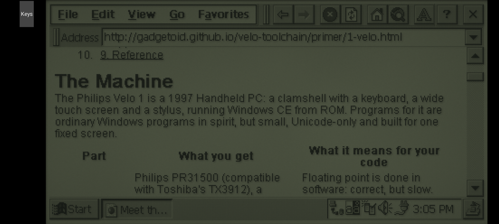
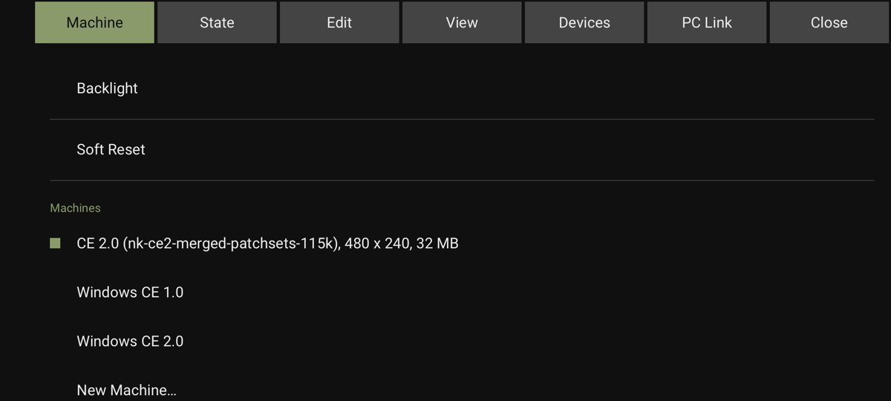
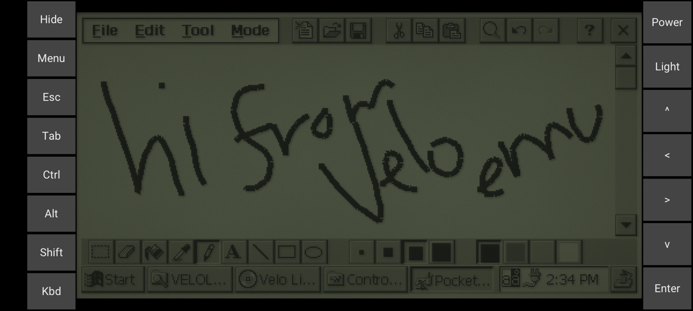

# Android

## Requirements

An arm64 phone or tablet with Android 9 or later, and the ROMs (see [using.md](using.md#roms)).

## Getting started

1. Install the `.apk` from a release.
2. On the first run, pick ROMs and card images from the phone's storage or Downloads. The app copies them in.
3. Machine > Import ROMs and Cards adds more later.

## Controls

A finger is the stylus. In landscape the controls run down both sides of the screen and in portrait across the top, leaving room for the keyboard below:

| Control | What it does |
| --- | --- |
| Hide | Folds them into a Keys tab and gives the screen the full height |
| Menu, or Back | Opens the menus as tabs. The ones that need a desktop (zoom, full screen, the pseudo-terminal and host serial ports) are left out. |
| Kbd | Opens the phone's keyboard, which types on the Velo |
| Ctrl, Alt, Shift | Stay down until tapped again, so Alt-Tab is Alt, Tab, Alt |
| Esc, Tab, the arrows, Enter | The Velo's keys |
| Power, Light | Its power and backlight buttons |

## Files

- Picked card, disk and snapshot files are copied into the app, under `Android/data/org.velo_emu.velo/files/velo-emu`. A saved snapshot goes where you choose.
- Save Screenshot puts it in Pictures/Velo, and Share Screen shares it.
- PC Link's Shared Folder and Copy My Documents need All files access, which they ask for, and choose a folder in the phone's storage.

## Notes

- Notices that the desktop shows in the title bar appear at the bottom of the screen.
- The unlit screen is dimmed to look like the Velo's reflective LCD. With the backlight on, the phone runs at full brightness (View > Full Brightness with Backlight turns that off).
- The phone stays awake while the Velo is on.
- Leaving the app saves the machine.
- [Optimisations](optimisations.md) are on by default.

Building the APK is covered in [building.md](building.md#android).
